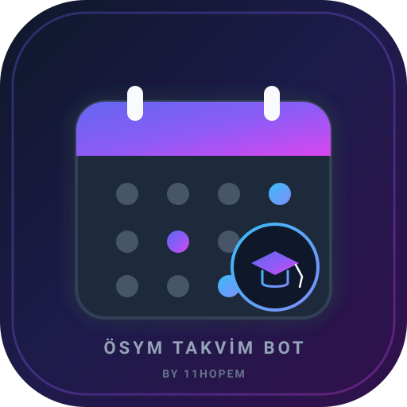

<!-- Created by 11Hopem -->
# 🗓️ ÖSYM Takvim Bot

<p align="center">
  
</p>

<p align="center">
  
  
  
  
  
</p>

---

## 1. Vizyon ve Genel Bakış (Overview & Vision)
**ÖSYM Takvim Bot**, ÖSYM'nin resmi web sitesindeki ([osym.gov.tr/Sayfa/SinavTakvimi](https://www.osym.gov.tr/Sayfa/SinavTakvimi)) güncel sınav takvimini her ayın 1'inde otonom olarak tarayan, belirlenen sınavların (**başvuru**, **geç başvuru** ve **sınav**) tarihlerini Apple Calendar (`Calendar.app`) üzerinden Google Takvim'deki **"ÖSYM Sınavları"** takvimine senkronize eden üretim standardında bir macOS arka plan servisidir.

Ek harici Python kütüphanesi veya paket yüklemesi (`pip install`) gerektirmez; tamamen macOS yerel araçları (`curl`, `osascript`, `launchd`) ve Python standart kütüphanesi ile sıfır bağımlılık prensibinde çalışır.

---

## 2. Proje Künyesi (Project Registry)
- **Geliştirici & Telif:** [11Hopem](https://11hopem.com)
- **GitHub Reposu:** `https://github.com/umutocguder/osym-takvim-bot` (Private)
- **Firebase Proje Kimliği:** `hopem-software-cloud` (Project Number: `691994382715`)
- **Geliştirme / Çalışma Alanı:** `/Users/umut/mycodespaces/osym-takvim-bot`
- **Antigravity IDE Proje ID:** `f9a6f409-9c11-46bf-8b99-e7fa3755831e`

---

## 3. Takip Edilen Sınavlar ve Kurallar (Tracked Exams & Filtering)

| Sınav Kodu | Takip Kapsamı | Hariç Tutulanlar |
|---|---|---|
| **ALES** | Tüm oturumlar (ALES/1, ALES/2, ALES/3) | - |
| **KPSS** | Yalnızca **Lisans** (Genel Yetenek-Genel Kültür, Alan Bilgisi) | Ön Lisans, Ortaöğretim, DHBT |
| **YÖKDİL** | Yalnızca kâğıt basılı sınavlar (YÖKDİL/1, YÖKDİL/2) | **e-YÖKDİL** elektronik oturumlar |
| **YDS** | Yalnızca kâğıt basılı sınavlar (YDS/1, YDS/2) | **e-YDS** elektronik oturumlar |

> [!NOTE]
> Sınav listesi ve filtreleme kuralları [`config.json`](file:///Users/umut/mycodespaces/osym-takvim-bot/config.json) üzerinden kolayca özelleştirilebilir.

---

## 4. Akıllı Hatırlatıcılar ve Takvim Etkinlikleri (Smart Events & Reminders)

| Etkinlik Türü | Biçim | Akıllı Hatırlatıcı Alarmları |
|---|---|---|
| **Başvuru** (Örn: `2026-ALES/3 · Başvuru`) | Tüm gün (Başlangıç → Bitiş) | İlk gün 09:00 ve Son gün 09:00 |
| **Geç Başvuru** (Örn: `2026-ALES/3 · Geç Başvuru`) | Tüm gün | İlk gün 09:00 (+ çok günlüyse son gün 09:00) |
| **Sınav** (Örn: `2026-ALES/3 · Sınav`) | Başlama saati varsa 3 saatlik, yoksa tüm gün | 1 hafta önce, 1 gün önce, sınavdan 2 saat önce |

- **İdempotent Senkronizasyon:** Her takvim etkinliğinin açıklamasında `osym-bot:<anahtar>#<parmak_izi>` etiketi saklanır. Aynı sınav tarihi tekrar tekrar eklenmez. ÖSYM takviminde bir değişiklik veya erteleme olduğunda eski etkinlik otomatik silinip yenisi güncellenir.
- **KPSS Başvuru Birleştirme:** KPSS Lisans oturumlarının başvuru tarihleri ortak olduğu için gereksiz mükerrerliği önlemek adına tek bir `"2026-KPSS Lisans · Başvuru"` etkinliği açılır.
- **Geçmiş Tarih Koruması:** Yalnızca bugünden sonraki güncel/gelecek etkinlikler takvime yazılır; geçmiş sınavlar eklenmez.

---

## 5. Mimari ve Dizin Ağacı (Architecture & Directory Tree)

```
osym-takvim-bot/
├── assets/                     # Vektörel logo, favicon ve marka varlıkları
│   ├── logo.svg
│   ├── favicon.svg
│   └── favicon.ico
├── config.json                 # Sınav filtreleri, etiketler ve takvim ayarları
├── data/                       # Otonom yedekler ve sağlama toplamları (Rule 17)
│   └── backups/
│       ├── osym_latest_backup.json
│       └── osym_checksums.json
├── launchd/                    # macOS LaunchAgent servis şablonu
│   └── com.umut.osym-takvim-bot.plist.template
├── logs/                       # Yerel veri kütükleri (Local Data Custody)
│   └── osym-takvim-bot_telemetry.jsonl
├── osym_bot/                   # Ana Python modülü
│   ├── __init__.py
│   ├── __main__.py             # CLI ve ana orkestrasyon motoru
│   ├── apple_calendar.py       # macOS Calendar (osascript/JXA) arayüzü
│   ├── events.py               # Etkinlik oluşturma ve filtreleme motoru
│   ├── scraper.py              # ÖSYM takvimi curl & HTML parser
│   └── telemetry/              # Enterprise telemetri ve PII temizleyici (Rule 7 & 18)
│       ├── firebase_config.py
│       └── logger.py
├── scripts/                    # Yönetim, kurulum ve yedekleme betikleri
│   ├── backup.py
│   ├── install.sh
│   └── uninstall.sh
├── tests/                      # Kapsamlı otomatik birim testleri (Rule 8)
│   ├── fixtures/
│   │   └── sinav_takvimi_2026.html
│   ├── test_backup.py
│   ├── test_bot.py
│   └── test_telemetry.py
├── AGENTS.md                   # Proje mimari ve geliştirme kuralları
├── CLAUDE.md                   # AI bağlam yönlendiricisi
├── pyproject.toml              # Paket üstverisi (11Hopem)
├── README.md                   # Kapsamlı kullanım kılavuzu
└── WORKLOG.md                  # Yapılan işler günlüğü (AI Handoff Ready)
```

---

## 6. Güvenlik, PII Temizleme ve Zero-Crash Güvencesi (Security & Shield)
- **Girdi Sanitizasyonu:** Tüm kütüklerde TCKN, kredi kartı, telefon ve Bearer JWT tokenları regex ile taranarak otomatik maskelenir.
- **Sıfır Bağımlılık:** Sistem kütüphanelerine ve güvenli macOS çekirdek araçlarına (`/usr/bin/curl`, `osascript`) dayanır.
- **Zero-Crash Güvencesi:** İnternet kesintisi veya ÖSYM web sitesinin geçici yanıt vermemesi durumunda çökmek yerine hata yakalanır, yerel kütüğe işlenir, çevrimdışı kuyruğa alınır ve kullanıcıya macOS sistem bildirimi gönderilir.

---

## 7. Cloud Firestore Telemetrisi (Rule 18 Streaming)
`osym_bot/telemetry/logger.py` modülü aracılığıyla `hopem-software-cloud` projesine ayrıştırılmış olay aktarımı sağlanır:
- `app_logs`: Eşleşen satırlar, planlanan sınav etkinlikleri ve durum kütükleri.
- `telemetry_logs`: Senkronizasyon performansı, oluşturulan ve güncellenen etkinlik istatistikleri.
- `crash_logs`: Web kazıma veya takvim erişiminde oluşan kritik istisnalar.
- `security_audit_logs`: Yetkisiz takvim veya dosya erişim denemeleri.

---

## 8. Otonom Veri Yedekleme Motoru (Rule 17 Autonomous Backup)
`scripts/backup.py` betiği yapılandırma ayarlarını ve sınav filtrelerini SHA-256 kriptografik özetiyle `data/backups/osym_latest_backup.json` dosyasına kaydeder. Döner kütük (`osym_checksums.json`) üzerinden son 30 yedekleme adımının bütünlüğü otomatik doğrulanır:
```bash
python3 scripts/backup.py
```

---

## 9. Kurulum ve Çalıştırma Komutları (Installation & Testing)

### Hizmeti Kurma (macOS LaunchAgent)
1. Google Takvim üzerinde **ÖSYM Sınavları** adlı bir takvim oluşturun.
2. Servisi kurun ve ilk senkronu hemen çalıştırın:
```bash
./scripts/install.sh --run-now
```
*(macOS "python3, Takvim'i denetlemek istiyor" uyarısı verdiğinde **İzin Ver** seçilmelidir).*

### Test ve Elle Senkronizasyon
```bash
# Takvime dokunmadan planlanan etkinlikleri listeleme (Dry-run)
python3 -m osym_bot --dry-run

# Elle tam senkronizasyon çalıştırma
python3 -m osym_bot

# Tüm otomatik testleri koşturma (%100 Başarı)
python3 -m unittest discover tests

# Servisi kaldırma
./scripts/uninstall.sh

# Canlı sistem logunu izleme
tail -f ~/Library/Logs/osym-takvim-bot.log
```

---

## 10. 11Hopem İmzası ve Telif Hakkı (Attribution & Legal)
Bu yazılım **[11Hopem](https://11hopem.com)** tarafından geliştirilmiştir.

```
Created by 11Hopem
Copyright (c) 2026 11Hopem. All rights reserved.
Licensed under 11Hopem Proprietary License.
```
Resmi Web Sitesi: [https://11hopem.com](https://11hopem.com)
İletişim: `umutocgdr@gmail.com`
